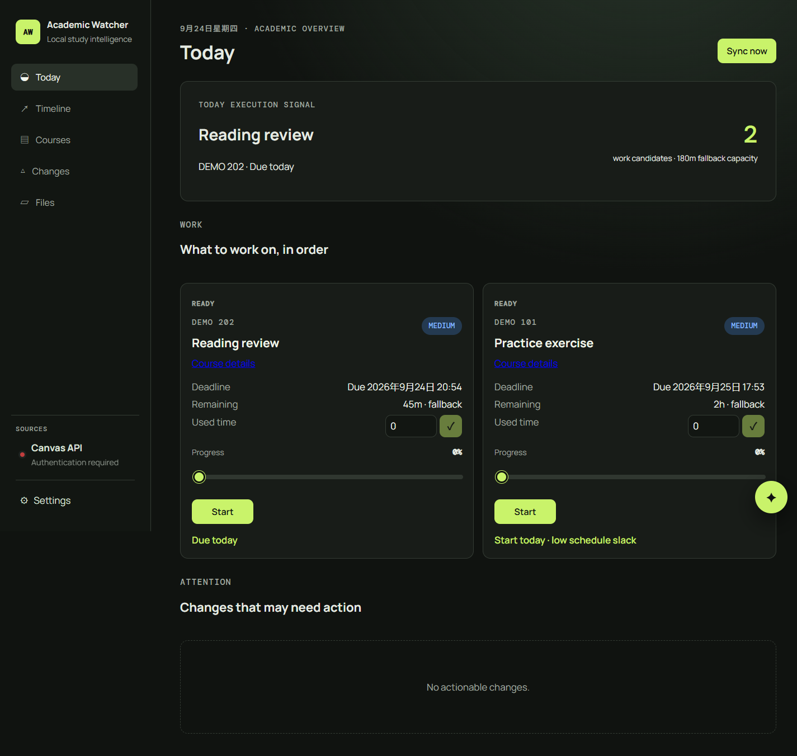

# CanvasWatcher / Academic Watcher

[English README](README.md) · [本地部署说明](DEPLOYMENT.md) · [多用户预览部署](DEPLOYMENT_MULTIUSER.zh-CN.md) · [GPL-2.0](LICENSE)

CanvasWatcher 从 Canvas 和受支持的课程网站汇集资料、截止日期、任务与有意义的变更，提供 Today 规划、文件历史、日历导入和可选 AI 辅助。来源同步只读；AI 写入操作需要明确确认。

默认 Docker Compose 部署是**本地优先的单用户应用**。此分支还包含**邀请制多用户预览实现**：身份网关、独立用户进程与存储，以及 `/watcher` 公网路径。多用户部署需要单独配置 HTTPS 反向代理并由 Linux 管理员实施；默认 Compose 命令不会启用它。



*截图来自真实运行的应用，使用合成演示数据，不含个人课程记录或凭据。*

## 本地启动

克隆仓库并安装 Docker Engine 或 Docker Desktop 与 Compose v2 后，在仓库目录运行：

```sh
cp .env.example .env
cp config/courses.example.yaml config/courses.runtime.yaml
cp config/file_rules.example.yaml config/file_rules.yaml
cp config/availability.example.yaml config/availability.yaml
docker compose up -d --build
```

打开 `http://127.0.0.1:8080`；API 健康检查位于 `http://127.0.0.1:8000/api/health`。Windows PowerShell 可用 `Copy-Item` 替代 `cp`。浏览器登录、升级与备份步骤见[部署说明](DEPLOYMENT.md)。

## 多用户预览

`identity-gateway/` 和 `ops/azure/` 包含邀请注册、会话与租户路由、逐用户供应器、Caddy 示例及 systemd 单元。每位用户拥有独立 SQLite 数据库、凭据库、文件树、进程和磁盘配额。网关通过 Unix socket 与内部令牌连接租户。示例域名 `watcher.example.com` 必须在安装前替换为自己的 HTTPS 域名。

Linux 安装脚本面向能够检查并调整 systemd、Caddy、存储与网络设置的管理员。安装前须先配置 `/etc/academic-watcher/public.env`。`ops/azure/import_owner.py` 只用于迁移已有单用户安装，必须显式指定原账号信息。本预览版尚无全新多用户安装的自动首位管理员初始化流程；如不准备自行实现该步骤，请使用本地 Compose 部署。不要直接向公网开放默认 Compose 端口。

## 功能与限制

- Canvas 与课程网站同步；Gradescope、PrairieLearn 适配器只读。PrairieLearn 已选课程解析尚未用真实已选课程验证。
- 截止日期、任务、文件、公告和成绩发布视图；ICS 日历只读导入。
- 可选 AI Chat 与概括。启用后，选定学业上下文可能发送给你配置的模型服务商。
- 可选桌面 Auth Broker，通过提供方官方页面完成浏览器登录；密码和 MFA 留在官方页面。
- SQLite 迁移、后端与前端测试，以及 Docker Compose 开发部署路径。

默认本地部署的凭据仅存在进程内存，除非明确启用加密持久化。升级前备份 `.env`、`data/` 和运行配置。不要提交 Token、Cookie、数据库、浏览器配置档或下载的课程文件。

## 源码结构

| 路径 | 用途 |
| --- | --- |
| `backend/` | FastAPI、来源适配、同步、数据库迁移与 AI 服务 |
| `frontend/` | React、TypeScript 界面 |
| `auth-broker/` | 桌面浏览器登录助手 |
| `identity-gateway/` | 邀请、会话与租户路由网关 |
| `ops/azure/` | 多用户 Linux 供应与服务配置示例 |

## 许可与开发

项目采用 [GNU GPL 第 2 版](LICENSE) 发布，第三方依赖保留各自许可。公开提交历史始于早期私有开发之后，不代表完整开发历史。开发过程中使用了 AI 编码代理，由人制定需求并完成审查。
